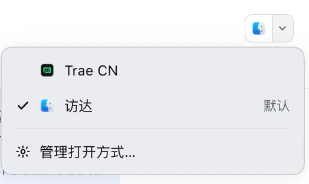

# dsh-open-with-control

English | [中文](README.md)

Customize the **Open with** menu in the DeepSeek Harness session header: choose which applications appear, reorder them, pin a default, and add any application installed on your machine — with real icons.

DeepSeek Harness ships an "Open In…" split button in the session header that opens the current workspace directory in an installed application. That menu is fixed: every application the host can detect is listed, in a fixed order, with a remembered last choice. This plugin replaces that control with a configurable one.



## Features

- **Choose what appears** — remove applications you never use; restore them later from a collapsed *Removed* section
- **Reorder** — move entries up and down; the menu follows your order
- **Pin a default** — the main button uses it; selecting an application in the menu also makes it the default
- **Add installed applications** — open the system applications folder and pick from what is actually installed, icons included
- **Real icons** — `.icns` on macOS, extracted executable icons on Windows
- **Localized** — Simplified Chinese and English
- **Safe floor** — at least one application always stays in the menu

The management panel:


## Requirements

- A DeepSeek Harness **Web** profile (`dsh web` / the Desktop app)
- The shipped `@deepseek-ai/dsh-host-open-in-app` and `@deepseek-ai/dsh-client-ui-open-in-app` rows (they are part of the `@deepseek-ai/dsh-web-app` bundle, so a Web profile has them)

## Install

```bash
dsh plugin --profile <profile> add dsh-open-with-control
```

Or from a local checkout:

```bash
dsh plugin --profile <profile> add /absolute/path/to/dsh-open-with-control
```

Then reload the page. The session header's Open with control now carries a **Manage open with…** row at the bottom of its menu.

## Use

Click the chevron next to the Open with button, then **Manage open with…**:

| Section | What you can do |
|---|---|
| *In the menu* | Reorder with the arrows, set the default, remove an entry |
| *Removed* | Collapsed by default; restore an entry, or delete a user-added one permanently |
| *Add system application* | **Open applications folder, pick apps…** lists what this machine has installed (with icons); check the ones you want |

Selecting an application in the header menu both opens the directory with it **and** makes it the new default.

## How it works

The plugin registers its own control into `conversation.session.header.utilities` at a lower slot priority than the shipped one, so it replaces that cell without patching the shipped package. Catalog applications keep using the shipped `open-in-app` routes for listing and launching; the plugin adds:

| Route | Purpose |
|---|---|
| `GET/POST /open-with-control/state` | Read or replace the stored preference document |
| `POST /open-with-control/open` | Launch a user-added application on a directory |
| `GET /open-with-control/system-apps` | List installed applications for the picker |
| `POST /open-with-control/system-open` | Launch an installed application on a directory |
| `GET /open-with-control/system-icon?path=…` | Serve one application's icon as PNG |

All routes sit behind the deployment's connection trust fence. Preferences live in `$DSH_HOME/storages/open-with-control.json`, written atomically.

## Platform notes

### macOS

- Applications are `.app` bundles discovered under `/Applications` and `~/Applications`
- Icons come from each bundle's `CFBundleIconFile` via `plutil` + `sips`
- Launching uses `open -a <bundle> <directory>`, so the application receives the directory

### Windows

- Applications are `.exe` files discovered up to three levels deep under `Program Files` and `Program Files (x86)`, each root with its own entry budget. Command-line toolchain folders (Git, MSYS2, nodejs, Windows Kits, Python's own tooling and similar) and helper executables (uninstallers, updaters, `pythonw`, `bin_*` launchers) are skipped, and one- or two-letter names are dropped as CLI shims
- Icons are extracted through PowerShell `System.Drawing`
- Launching starts the executable with the directory as its argument

Windows limitations worth knowing:

- **Whether the directory is honored depends on the application.** There is no `open -a` equivalent; the path is passed as a plain argument. Editors and IDEs that accept a folder argument (VS Code, Cursor, …) work; applications that ignore arguments will just launch.
- **Helper executables appear in the list.** Recursive scanning surfaces things like `uninstall.exe` or `vc_redist.x64.exe`; pick deliberately.
- **Microsoft Store (UWP) applications are not listed** — they do not live under Program Files.
- **Icon extraction needs PowerShell with `System.Drawing`.** Where it fails, entries simply render without an icon.

### Linux

Not supported yet: the application picker has no Linux discovery, so it reports no applications. Catalog applications from the shipped package keep working.

## Known limitations

- **Catalog applications cannot be deleted, only removed.** The host re-discovers installed editors, terminals, and file managers on every load, so removing one records it as removed rather than dropping it; this is what *Restored* restores. Applications you added yourself are truly deleted.
- **The installed-application list is read on demand.** An application installed while the page is open appears after reopening the picker.
- **The system application list is not filtered by relevance.** Every bundle/executable found is offered.

## Development

The package is a Cordis bundle: `index.js` is the Host half, `client.js` the browser half, `cordis.patch.yml` mounts the row. No build step — both halves ship as source.

```bash
node --check index.js
node --check client.js
```

## License

MIT
