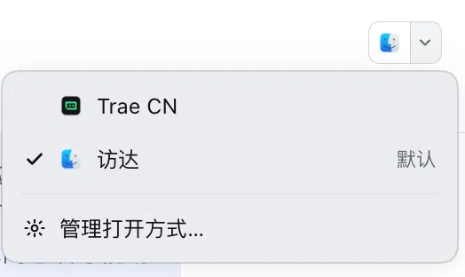
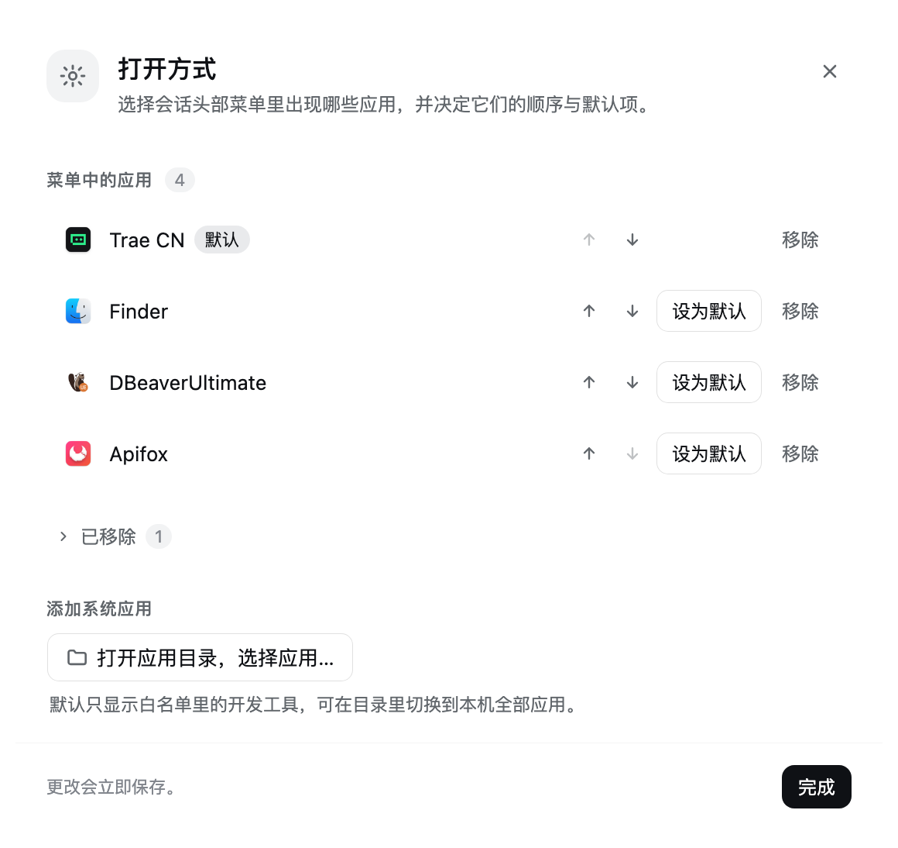

# dsh-open-with-control

[English](README.en.md) | 中文

自定义 DeepSeek Harness 会话头部右上角的**「打开方式」**菜单：选择显示哪些应用、调整顺序、设定默认应用，并把本机已安装的应用加进来——带真实图标。

DeepSeek Harness 自带一个「打开方式」分裂按钮，用已安装的应用打开当前工作目录。但那个菜单是固定的：宿主能探测到的应用全部列出、顺序固定、只记住上次选择。本插件用一个可配置的控件替换它。



## 功能

- **决定显示哪些应用**——不需要的应用直接移除；之后可从折叠的「已移除」区恢复
- **调整顺序**——上移/下移，菜单按你的顺序排列
- **设定默认应用**——主按钮用它打开；在菜单里点选某个应用也会把它设为默认
- **添加已安装的应用**——打开系统应用目录，从本机真实安装的应用里挑选，带图标
- **真实图标**——macOS 取 `.icns`，Windows 提取可执行文件图标
- **中英双语**
- **保底约束**——菜单里至少保留一个应用

管理面板：



## 环境要求

- DeepSeek Harness 的 **Web** 形态（`dsh web` 或桌面版）
- 官方自带的 `@deepseek-ai/dsh-host-open-in-app` 与 `@deepseek-ai/dsh-client-ui-open-in-app` 两行（它们属于 `@deepseek-ai/dsh-web-app` 捆绑包，Web 形态默认就有）

## 安装

```bash
dsh plugin --profile <profile> add dsh-open-with-control
```

或从本地目录安装：

```bash
dsh plugin --profile <profile> add /absolute/path/to/dsh-open-with-control
```

然后刷新页面。会话头部的「打开方式」控件菜单底部会多出一行 **「管理打开方式…」**。

## 使用

点「打开方式」按钮右侧的箭头，再点「管理打开方式…」：

| 区块 | 可以做什么 |
|---|---|
| *菜单中的应用* | 用箭头调整顺序、设为默认、移除 |
| *已移除* | 默认折叠；恢复某个应用，或把自定义应用彻底删除 |
| *添加系统应用* | 点「打开应用目录，选择应用…」，列出本机已安装的应用（带图标），勾选后加入 |

在头部菜单里点选某个应用时，会**同时**用它打开当前目录，并把它设为新的默认应用。

## 实现方式

插件把自己的控件注册进 `conversation.session.header.utilities`，并以比官方更低的 slot 优先级占用同一个格子，从而替换掉那个控件，而不需要改动官方包。内置目录应用继续复用官方的 `open-in-app` 路由做列举和启动；插件额外提供：

| 路由 | 用途 |
|---|---|
| `GET/POST /open-with-control/state` | 读取或替换偏好文档 |
| `POST /open-with-control/open` | 用自定义应用打开某个目录 |
| `GET /open-with-control/system-apps` | 列出本机已安装的应用，供选择器使用 |
| `POST /open-with-control/system-open` | 用已安装的应用打开某个目录 |
| `GET /open-with-control/system-icon?path=…` | 以 PNG 返回某个应用的图标 |

所有路由都在部署的 connection 信任校验之后。偏好保存在 `$DSH_HOME/storages/open-with-control.json`，采用原子写入。

## 平台说明

### macOS

- 应用是 `/Applications` 与 `~/Applications` 下的 `.app` 包
- 图标通过 `plutil` 读 `CFBundleIconFile`，再用 `sips` 转成 PNG
- 启动使用 `open -a <应用包> <目录>`，应用收到的是目录本身

### Windows

- 应用是 `Program Files` 与 `Program Files (x86)` 下最多三层的 `.exe`，每个根目录各有独立的条目预算。命令行工具目录（Git、MSYS2、nodejs、Windows Kits 等）和辅助程序（卸载程序、更新程序、`pythonw`、`bin_*` 启动器）会被跳过，一两个字母的名字视为命令行垫片而丢弃
- 图标通过 PowerShell 的 `System.Drawing` 提取
- 启动时把目录作为参数传给该可执行文件

Windows 上需要知道的限制：

- **目录参数是否生效取决于应用本身。** Windows 没有 `open -a` 这种统一入口，路径只是作为普通参数传入。支持接收目录参数的编辑器/IDE（VS Code、Cursor 等）没问题；忽略参数的应用则只会被启动。
- **会扫出辅助程序。** 递归扫描会把 `uninstall.exe`、`vc_redist.x64.exe` 之类也列出来，需要自己甄别。
- **Microsoft Store（UWP）应用不会出现**——它们不在 Program Files 下。
- **图标提取依赖 PowerShell 的 `System.Drawing`。** 提取失败时该条目只是没有图标，不影响使用。

### Linux

暂不支持：应用选择器没有 Linux 探测逻辑，因此会显示没有应用。官方包提供的目录应用仍然可用。

## 已知限制

- **内置目录应用只能移除，不能删除。** 宿主每次加载都会重新探测已安装的编辑器、终端和文件管理器，所以「移除」只是记录下来，这也是「已移除」区能恢复它们的原因。你自己添加的应用则是真正删除。
- **已安装应用列表是按需读取的。** 页面打开期间新装的应用，需要重新打开选择器才会出现。
- **系统应用列表没有做相关性过滤。** 扫描到的每个应用包/可执行文件都会列出来。

## 开发

本包是一个 Cordis 捆绑包：`index.js` 是宿主端，`client.js` 是浏览器端，`cordis.patch.yml` 负责挂载。没有构建步骤，两端都直接以源码发布。

```bash
node --check index.js
node --check client.js
```

## 许可证

MIT
